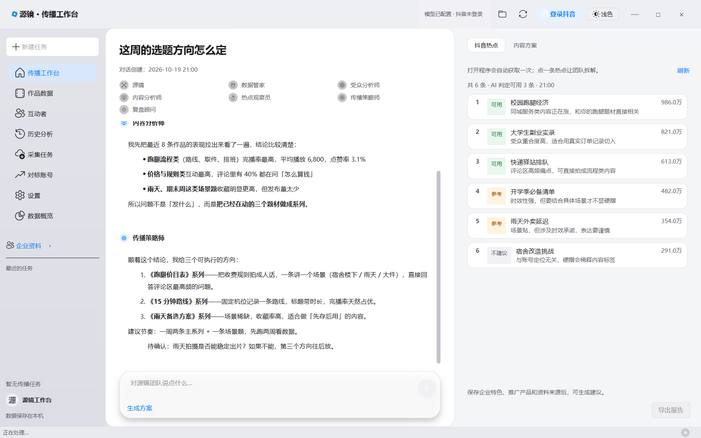

# 源镜 · 传播工作台

**本地运行的抖音传播 AI 团队**：七个各司其职的 agent 替你把数据取回来、把表现读明白、把下一步想清楚。
数据落在你自己的电脑上，只有你主动调用在线模型时才会发送必要的摘要。



## 它不是一个只会聊天的助手

你说清楚要什么，团队自己派活：

| 角色 | 职责 |
|---|---|
| 源镜（总管） | 接单派活，能答就答，需要取数/分析时交给对应同事 |
| 数据管家 | 登录、取点赞人与公开资料、洗库并汇报 |
| 受众分析师 | 互动者画像与群体洞察，只依据已采集数据 |
| 内容分析师 | 播放、互动、题材与发布节奏的诊断 |
| 热点观察员 | 盯抖音热榜，标注「可用 / 参考 / 不建议」并说明理由 |
| 传播策略师 | 把结论落成可执行的选题与节奏 |
| 复盘顾问 | 整理报告、对比历史方案与实际表现 |

## 能力

- **对话式工作流**：取数、诊断、出方案在同一条对话里完成，结论可以继续追问
- **抖音数据**：本人作品、播放点赞评论转发、点赞人与评论人、公开资料与作品样本、评论区抽样采集
- **主页兜底**：接口被风控时改用真实浏览器捕获页面响应，仍能落库并标记采集模式
- **热点评估**：热榜实时抓取 + 逐条可用性判定，区分【热点事实】与【结合建议】
- **作品观看**：视频可在工作台内直接播放，图文作品支持图片翻页；缓存有容量上限与自动清理
- **质量检查**：统计异常、待核验关联、资料缺失都会标出来，不悄悄改数据
- **本地优先**：SQLite + 本地浏览器配置目录；登录态、报告、缓存都只在本机
- **界面**：原生 PySide6 桌面程序，明暗双主题，Fluent 风格控件

## 快速开始

```powershell
# 首次：建环境并安装依赖（需要联网）
pwsh -File scripts/setup.ps1

# 跑桌面版
.venv\Scripts\python.exe desktop\app.py
```

也可以双击 `desktop\启动.bat`（日常启动）或 `desktop\开发预览.bat`（改代码自动重载）。

首次启动需要登录抖音：点右上角「登录抖音」，在弹出的真实浏览器里扫码，登录态会保存在本地。

## 测试与自检

```powershell
.venv\Scripts\python.exe -m pytest -q                      # 测试套件
.venv\Scripts\python.exe scripts\smoke.py                  # 免依赖核心自检
.venv\Scripts\python.exe scripts\check_desktop_startup.py  # 桌面启动冒烟（离屏）
```

> GUI 测试文件（`test_appearance` / `test_desktop` / `test_enterprise_gui` / `test_harness` / `test_workflow_gui`）
> 不要放在同一个进程里跑，分开执行更稳。

## 打包

```powershell
# 生成 exe（PyInstaller，图标取 brand/源镜_App图标.svg 生成的 ico）
desktop\打包.bat
```

品牌资源在 `brand/`（SVG 为准）。改了 logo 之后执行：

```powershell
.venv\Scripts\python.exe scripts\build_brand_assets.py   # 生成 png / ico / 站点矢量
```

## 目录

```
src/scout/
  analyze/       AI 团队名册、对话路由、报告生成
  collect/       采集器（作品、点赞人、评论、热榜、本人资料）
  parse/         通用抽取与精确解析器
  store/         SQLite 数据仓储与查询
  desktop/       桌面界面（工作台、采集任务、设置、品牌资源）
site/            产品落地页（纯静态，可直接用 GitHub Pages 托管）
brand/           品牌源文件（SVG / PNG）
```

## 数据与隐私

- 采集、解析、报告生成全部在本机完成
- 只有你主动使用在线模型生成分析时，才会把需要的企业资料与作品摘要发送给你自己配置的模型服务
- 不实现抖音请求签名、不绕过任何技术保护措施：请求由真实浏览器用页面自身的 JS 发出，程序只归档响应
- 视频与图片缓存默认上限 500MB，超限按最久未访问删除，7 天未访问自动清理

## 许可

本项目整体以 **GNU GPL v3.0** 发布，见 [LICENSE](LICENSE)（原因是运行时分发依赖的
PySide6-Fluent-Widgets 采用 GPL-3.0）。要点：

- 可以自由使用、修改、商用、再分发，但**分发时必须提供完整对应源代码**（本仓库即源码）
- 不得对分发的产物附加额外限制（禁止再分发、仅限个人使用之类）
- `brand/` 下的名称与标志是商标，不在 GPL 授权范围内，二次开发请改名换图
- 第三方组件与许可明细、以及 Qt 的 LGPL 注意事项见 [THIRD_PARTY.md](THIRD_PARTY.md)

## 产品主页

`site/` 是静态落地页，浏览器直接打开即可：

```
site/index.html
```
