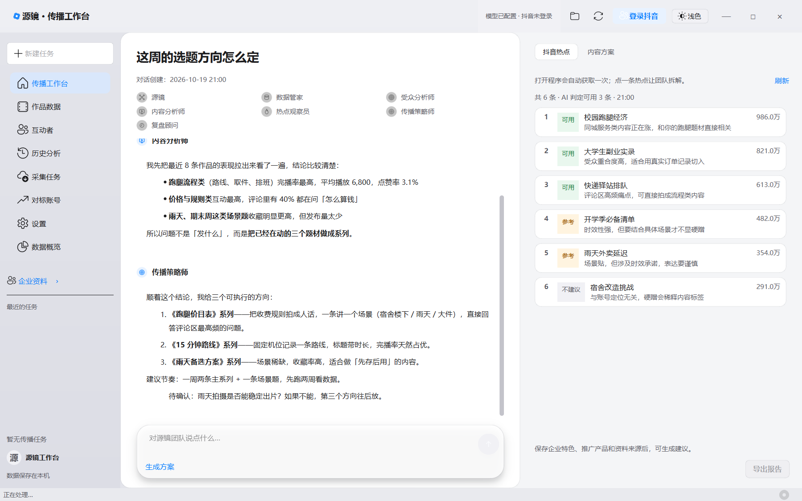

# 源镜 · 传播工作台

**本地运行的抖音传播 AI 团队**：七个各司其职的 agent 替你把数据取回来、把表现读明白、把下一步想清楚。
数据落在你自己的电脑上，只有你主动调用在线模型时才会发送必要的摘要。



## 它不是一个只会聊天的助手

你说清楚要什么，团队自己派活：

| 角色 | 职责 |
|---|---|
| 源镜（总管） | 接单派活，能答就答，需要取数/分析时交给对应同事 |
| 数据管家 | 登录、取点赞人与公开资料、洗库并汇报 |
| 受众分析师 | 互动者画像与群体洞察，只依据已采集数据 |
| 内容分析师 | 播放、互动、题材与发布节奏的诊断 |
| 热点观察员 | 盯抖音热榜，标注「可用 / 参考 / 不建议」并说明理由 |
| 传播策略师 | 把结论落成可执行的选题与节奏 |
| 复盘顾问 | 整理报告、对比历史方案与实际表现 |

## 能力

- **对话式工作流**：取数、诊断、出方案在同一条对话里完成，结论可以继续追问
- **素材工作区**：完整索引压缩包，生成全部图片与视频封面的缩略图联系表；逐批总览后按编号看原图、放大区域或视频时间点，观察和进度随任务保存，支持中断继续。见 [使用与验收](docs/material-workspace.md)。
- **拖拽附件**：将图片、视频、PDF、Word、表格、演示文稿或文本拖入输入区；紧凑缩略图与文件卡片支持预览、移除，发送后随会话保存在本机。图片由支持视觉的模型识别，视频按时间点抽帧分析，文档在本地提取文字。
- **抖音数据**：本人作品、播放点赞评论转发、点赞人与评论人、公开资料与作品样本、评论区抽样采集
- **主页兜底**：接口没有数据或不可用时，改用真实浏览器页面的响应兜底，仍能落库并标记采集模式
- **热点评估**：热榜实时抓取 + 逐条可用性判定，区分【热点事实】与【结合建议】
- **热点视频**：热榜每条可取代表视频与相关视频，工作台内直接播放；点「交给团队」把视频作为附件开一个新对话，团队按帧分析并给出借势建议
- **作品观看**：作品数据点行开右侧抽屉，视频边下边播（可拖进度），图文横向翻页；需要留档时点「保存到本机」
- **数据概览**：作品与受众页顶部给出趋势与结构图——每周播放/点赞、粉丝量分布、互动深度、近 30 天新增互动；悬停读数、可展开数据表
- **应用内更新**：启动时静默检查新版本，设置页下载、校验 sha256，退出后由可见的批处理替换并重启；源码运行只提示、不替换
- **附件预览**：图片与视频在工作台内直接查看；浏览器不支持的编码按需转码，预览文件只留在本机
- **质量检查**：统计异常、待核验关联、资料缺失都会标出来，不悄悄改数据
- **本地优先**：SQLite + 本地浏览器配置目录；登录态、报告、预览缓存都只在本机
- **界面**：WebView2 窗口加载本地 React 前端（随包离线可用），明暗双主题；左下角账号菜单统一收口「账号与安全 / 隐私说明 / 设置」，均为圆角弹窗

## 快速开始

```powershell
# 首次：建环境并安装依赖（需要联网）
pwsh -File scripts/setup.ps1

# 跑桌面版（WebView2 窗口）
.venv\Scripts\python.exe desktop-html\windows.py
```

也可以双击 `desktop-html\启动.bat`（日常启动）或 `desktop-html\开发窗口.bat`（Vite 热更新，改前端代码自动刷新）。

运行源码版需要 Microsoft Edge WebView2 运行时（Windows 11 自带）与 .NET Framework 4.7.2 以上。

首次启动需要登录抖音：点左下角账号栏 →「账号与安全」→「登录抖音」，在弹出的真实浏览器里扫码，登录态会保存在本地。

## 测试与自检

```powershell
.venv\Scripts\python.exe -m pytest -q                      # 测试套件
.venv\Scripts\python.exe scripts\smoke.py                  # 免依赖核心自检
.venv\Scripts\python.exe scripts\check_html_desktop.py     # 浏览器界面验收（真实上传/流式/确认/停止）
.venv\Scripts\python.exe scripts\check_windows_release.py  # 发布包离线验收
```

> `scripts/check_html_desktop.py` 会真实启动本地服务与浏览器，覆盖导航、附件上传、
> 流式回答、历史恢复、拖拽、确认与停止；约需 1–2 分钟，结束时写 `tmp/html-desktop/acceptance/report.json`。

## 打包

普通 Agent 对话由 Codex Rust 内核执行，模型继续使用 DeepSeek；安装要求与实际大压缩包验收见 [Codex 执行引擎](docs/codex-runtime.md)。

```powershell
# 生成 exe（PyInstaller，图标取 brand/源镜_App图标.svg 生成的 ico）
.venv\Scripts\python.exe scripts\build_windows_release.py
```

产物在 `dist/windows/`；脚本同时做杀软实测并写 `release-verification.json`。

品牌资源在 `brand/`（SVG 为准）。改了 logo 之后执行：

```powershell
.venv\Scripts\python.exe scripts\build_brand_assets.py   # 生成 png / ico / 站点矢量
```

## 目录

```
src/scout/
  analyze/       AI 团队名册、对话路由、报告生成
  collect/       采集器（作品、点赞人、评论、热榜、本人资料）
  parse/         通用抽取与精确解析器
  store/         SQLite 数据仓储与查询
  desktop/       桌面后端（运行时、设置服务、动作、品牌资源）
  web_desktop/   本地回环 API 与 WebView2 载体
desktop-html/    前端源码（React + Vite）与 Windows 启动入口
site/            产品落地页（纯静态，可直接用 GitHub Pages 托管）
brand/           品牌源文件（SVG / PNG）
```

## 数据与隐私

- 采集、解析、报告生成全部在本机完成；数据在账号自己的目录里（源码版 `desktop/userdata/`，打包版 `%LOCALAPPDATA%\douyin-scout\`），没有云端账号
- 只有你主动使用在线模型生成分析时，才会把必要的摘要（作品指标、文本片段、你导入的附件）发送给你自己配置的模型服务；登录态与数据库不外发
- 技术边界：不实现抖音请求签名，不伪造浏览器指纹，不破解验证码，不使用代理池或并发；请求由你自己登录的真实浏览器发出，程序只读取浏览器已经拿到的响应
- 自动化访问是否被平台允许，取决于平台规则与你的账号授权，本程序不作保证——请只采集你有权访问的数据
- 默认保留：归档正文 7 天、日志 30 天、已完成任务 14 天；可导出 CSV，或删除账号目录整体清除
- 支持**按人删除**：互动受众详情里的「删除此人数据」，或 `scout forget <sec_uid>`；删除前显示条数
- 互动者资料属于他人个人信息：不公开、不对外提供，展示前先匿名化。完整说明见 [数据与隐私](docs/privacy.md)

## 许可

本项目整体以 **GNU GPL v3.0** 发布，见 [LICENSE](LICENSE)。要点：

- 可以自由使用、修改、商用、再分发，但**分发时必须提供完整对应源代码**（本仓库即源码）
- 不得对分发的产物附加额外限制（禁止再分发、仅限个人使用之类）
- `brand/` 下的名称与标志是商标，不在 GPL 授权范围内，二次开发请改名换图
- 第三方组件与许可明细见 [THIRD_PARTY.md](THIRD_PARTY.md)。早期版本因 PySide6-Fluent-Widgets
  采用 GPL-3.0 而选择 GPL；该依赖已随 Qt 界面移除，当前依赖中已无强制 GPL 的库，
  是否改用更宽松的许可留给维护者另行决定。

## 产品主页

`site/` 是静态落地页，浏览器直接打开即可：

```
site/index.html
```
